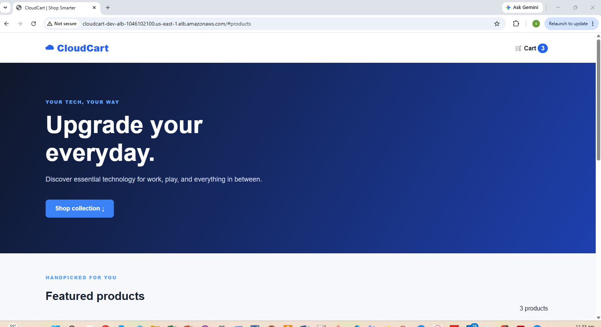

# CloudCart — AWS Cloud-Native E-Commerce Platform

CloudCart is a containerized e-commerce demo deployed on AWS with **Terraform, ECS Fargate, RDS PostgreSQL, ECR, and an Application Load Balancer**. It demonstrates cloud architecture, secure networking, infrastructure automation, and end-to-end application deployment.

**Status:** Core AWS deployment completed and tested · **Next:** Automated ECS delivery (CI/CD)

[](https://aws.amazon.com/)
[](https://www.terraform.io/)
[](https://www.python.org/)
[](https://flask.palletsprojects.com/)
[](https://www.docker.com/)
[](https://aws.amazon.com/fargate/)
[](https://www.postgresql.org/)
[](https://github.com/features/actions)
[](https://www.gnu.org/software/bash/)

## AWS Architecture


**Request path:** Browser → ALB → ECS Fargate (Flask) → RDS PostgreSQL. ECS and RDS run in private subnets; IAM, Secrets Manager, security groups, VPC endpoints, and CloudWatch support the deployment.

## Table of Contents

1. [AWS Architecture](#aws-architecture)
2. [Project Highlights](#project-highlights)
3. [Technology Stack](#technology-stack)
4. [Application Features](#application-features)
5. [Deployment Screenshots](#deployment-screenshots)
6. [Deployment Results](#deployment-results)
7. [Infrastructure Automation](#infrastructure-automation)
8. [CI and Roadmap](#ci-and-roadmap)
9. [Technical Documentation](#technical-documentation)
10. [Security and Cost Notes](#security-and-cost-notes)

## Project Highlights

- Designed a VPC spanning **two Availability Zones**, with public, private application, and private database subnets.
- Provisioned infrastructure using **reusable Terraform modules**.
- Deployed a containerized **Flask storefront** on ECS Fargate behind an ALB.
- Initialized a private **RDS PostgreSQL** database using a one-time ECS task.
- Added Bash scripts for repeatable infrastructure planning, deployment, and teardown.
- Troubleshot and resolved an ECS service provisioning issue that initially caused ALB HTTP 503 responses.

## Technology Stack

| Area | Tools |
|---|---|
| Cloud & networking | AWS VPC, ALB, ECS Fargate, ECR, RDS |
| IaC & automation | Terraform, Bash |
| Application | Python 3.12, Flask, HTML, CSS, JavaScript |
| Database | PostgreSQL 16 |
| Security & operations | IAM, Secrets Manager, security groups, VPC endpoints, CloudWatch Logs |
| CI & source control | GitHub Actions, GitHub, Docker |

## Application Features

- Responsive storefront with product catalog loaded from PostgreSQL.
- Product details, prices, and inventory information.
- Interactive demo shopping cart.
- Product API and health/readiness endpoints.

*Checkout, payment processing, and persistent cart/order storage are not implemented.*

## Deployment Screenshots

### Live CloudCart Storefront



Additional deployment evidence can be added under `docs/screenshots/` as screenshots become available.

## Deployment Results

| Verification | Outcome |
|---|---|
| Terraform deployment | Successful; subsequent plan showed no changes |
| Database initialization task | Exited with code `0` |
| Storefront via public ALB | Accessible |
| PostgreSQL-backed catalog | Three products displayed |
| Demo shopping cart | Add to Cart tested successfully |
| GitHub repository | Published to `main` |

## Infrastructure Automation

```bash
bash scripts/plan.sh     # Preview infrastructure changes
bash scripts/deploy.sh   # Deploy or update dev infrastructure
bash scripts/destroy.sh  # Tear down dev infrastructure after review
```

See the [implementation guide](docs/implementation-guide.md) for deployment order, prerequisites, and database initialization.

## CI and Roadmap

**Implemented CI:** GitHub Actions runs Python API tests, builds the Docker image, and validates Terraform on pushes and pull requests.

**Planned CD:** Publish immutable images to ECR, update ECS task definitions, deploy through GitHub Actions using OIDC, and verify release health. CloudFront, Route 53, HTTPS, WAF, and advanced disaster recovery are future enhancements—not part of the validated deployment.

## Technical Documentation

- [Implementation Guide](docs/implementation-guide.md) — architecture details, Terraform modules, deployment flow, APIs, and operational commands.
- [Troubleshooting & Lessons Learned](docs/troubleshooting.md) — ECS 503 investigation, Terraform module wiring, database initialization, and operational lessons.

## Security and Cost Notes

The dev deployment uses private ECS/RDS subnets, security groups, IAM roles, and Secrets Manager. **The public ALB currently uses HTTP**, so this is a portfolio demo, not a production payment system. RDS, ALB, Fargate, and VPC endpoints may incur charges while deployed; review and run `bash scripts/destroy.sh` when finished. Check separately managed resources and retained snapshots afterward.
