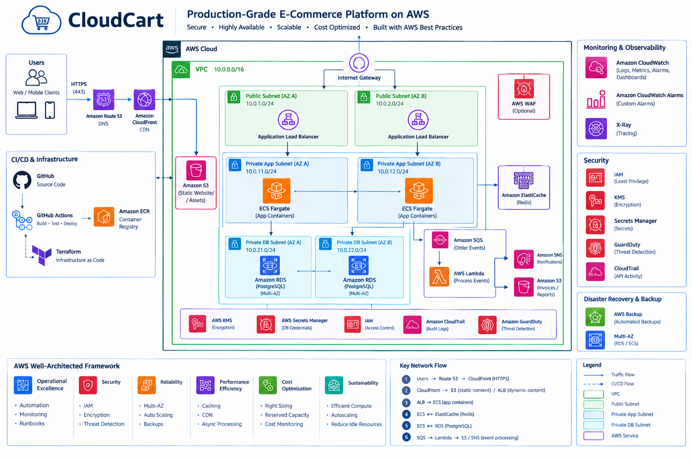

# CloudCart — AWS Cloud-Native E-Commerce Platform

CloudCart is a containerized e-commerce demonstration application designed, provisioned, and deployed on AWS using Terraform, Amazon ECS Fargate, Amazon RDS PostgreSQL, Amazon ECR, and an Application Load Balancer.

The project demonstrates practical experience in **Cloud Engineering, Platform Engineering, Infrastructure as Code, AWS Networking, Containerization, Security, and Infrastructure Automation**.

**Project Status: Core AWS deployment successfully completed and tested.**

[](https://aws.amazon.com/)
[](https://www.terraform.io/)
[](https://www.python.org/)
[](https://flask.palletsprojects.com/)
[](https://www.docker.com/)
[](https://aws.amazon.com/fargate/)
[](https://www.postgresql.org/)
[](https://github.com/features/actions)
[](https://www.gnu.org/software/bash/)

---

## AWS Architecture



The architecture follows a multi-tier design with public-facing load balancing, containerized application workloads in private subnets, and a managed PostgreSQL database.

**Request Flow:**

Browser → Application Load Balancer → Amazon ECS Fargate → Amazon RDS PostgreSQL

Supporting infrastructure includes:

- **Amazon VPC:** Network isolation with public and private subnets across two Availability Zones.
- **Application Load Balancer:** HTTP traffic routing and health checks.
- **Amazon ECS Fargate:** Serverless container orchestration for the Flask application.
- **Amazon ECR:** Private Docker image registry.
- **Amazon RDS PostgreSQL:** Managed relational database deployed in private subnets.
- **AWS IAM:** Role-based access and least-privilege permissions.
- **AWS Secrets Manager:** Secure database credential management.
- **VPC Endpoints:** Private connectivity to supported AWS services.
- **Amazon CloudWatch Logs:** Centralized container logging.
- **Terraform:** Infrastructure provisioning using reusable modules.
- **Bash:** Infrastructure lifecycle automation.
- **GitHub Actions:** Continuous integration and Terraform validation.

---

## Table of Contents

1. [AWS Architecture](#aws-architecture)
2. [Project Objectives](#project-objectives)
3. [Application Features](#application-features)
4. [Technology Stack](#technology-stack)
5. [Infrastructure Design](#infrastructure-design)
6. [Repository Structure](#repository-structure)
7. [Infrastructure Automation](#infrastructure-automation)
8. [Deployment Workflow](#deployment-workflow)
9. [Docker Images](#docker-images)
10. [API Endpoints](#api-endpoints)
11. [Continuous Integration](#continuous-integration)
12. [Deployment Verification](#deployment-verification)
13. [Deployment Screenshots](#deployment-screenshots)
14. [Challenges and Lessons Learned](#challenges-and-lessons-learned)
15. [Security and Limitations](#security-and-limitations)
16. [Future Enhancements](#future-enhancements)
17. [Cost Management](#cost-management)
18. [Project Outcome](#project-outcome)

---

## Project Objectives

The primary goal of CloudCart is to demonstrate the ability to design, provision, deploy, and operate a cloud-native application using industry-standard AWS and DevOps practices.

Key objectives include:

- Design a secure multi-tier AWS architecture.
- Implement networking across multiple Availability Zones.
- Provision AWS infrastructure using reusable Terraform modules.
- Containerize and deploy a Python Flask application.
- Configure private database connectivity.
- Manage sensitive credentials using AWS Secrets Manager.
- Automate infrastructure lifecycle operations using Bash.
- Validate application functionality through automated tests.
- Implement continuous integration using GitHub Actions.
- Gain hands-on experience troubleshooting real AWS deployment issues.

---

## Application Features

CloudCart provides a responsive e-commerce demonstration application with:

- Product catalog retrieved from PostgreSQL.
- Product pricing and inventory information.
- Interactive shopping cart.
- REST API endpoints for product retrieval.
- Application health and database readiness endpoints.
- Responsive frontend built with HTML, CSS, and JavaScript.

**Note:** The shopping cart is a frontend demonstration. Checkout, payment processing, order persistence, and customer authentication are not implemented.

---

## Technology Stack

| Category | Technology |
|---|---|
| Cloud Provider | Amazon Web Services |
| Infrastructure as Code | Terraform |
| Infrastructure Automation | Bash |
| Programming Language | Python 3.12 |
| Backend Framework | Flask |
| Frontend | HTML, CSS, JavaScript |
| Database | PostgreSQL 16 |
| Containerization | Docker |
| Container Orchestration | Amazon ECS Fargate |
| Container Registry | Amazon ECR |
| Networking | Amazon VPC, ALB |
| Security | AWS IAM, Security Groups, Secrets Manager |
| Private AWS Connectivity | VPC Endpoints |
| Logging | Amazon CloudWatch Logs |
| Continuous Integration | GitHub Actions |
| Version Control | Git and GitHub |

---

## Infrastructure Design

### Networking

The network architecture uses a VPC with the CIDR block `10.0.0.0/16`, spanning two Availability Zones.

| Subnet | CIDR | Purpose |
|---|---|---|
| Public A | `10.0.0.0/24` | Public-facing infrastructure |
| Public B | `10.0.1.0/24` | Public-facing infrastructure |
| Private App A | `10.0.2.0/24` | ECS application workloads |
| Private App B | `10.0.3.0/24` | ECS application workloads |
| Private DB A | `10.0.4.0/24` | Database networking |
| Private DB B | `10.0.5.0/24` | Database networking |

The deployment uses VPC endpoints for private access to required AWS services, reducing dependence on NAT gateways.

### Compute

The application runs on Amazon ECS using AWS Fargate.

The ECS service is configured with:

- A Docker-based Flask application.
- Private application subnet placement.
- ALB integration.
- Application health checks.
- Service autoscaling configuration.
- IAM task execution and application roles.

### Database

Amazon RDS PostgreSQL provides persistent product data.

The database is:

- Deployed without public internet access.
- Accessible through controlled security group rules.
- Initialized using a one-time ECS Fargate task.
- Configured to use AWS-managed database credentials through Secrets Manager.

### Security

Security controls include:

- Least-privilege IAM roles.
- Private ECS and database networking.
- Security group restrictions between application tiers.
- Database credentials stored in AWS Secrets Manager.
- Private connectivity through VPC endpoints.

---

## Repository Structure

```text
cloudcart-aws-terraform/
├── .github/
│   └── workflows/
│       └── ci.yml
├── app/
│   ├── src/
│   │   ├── main.py
│   │   ├── static/
│   │   └── templates/
│   ├── tests/
│   └── Dockerfile
├── database/
│   ├── Dockerfile
│   └── init.sql
├── scripts/
│   ├── plan.sh
│   ├── deploy.sh
│   └── destroy.sh
├── terraform/
│   ├── environments/
│   │   └── dev/
│   └── modules/
│       ├── networking/
│       ├── security/
│       ├── ecr/
│       ├── iam/
│       ├── ecs/
│       ├── alb/
│       ├── rds/
│       └── vpc-endpoints/
├── screenshots/
├── cloudcart-architecture.png
├── compose.yaml
├── .env.example
└── README.md
```

The `screenshots/` directory is intended for deployment evidence and should be populated with actual screenshots.

---

## Infrastructure Automation

Infrastructure lifecycle operations are automated using Bash scripts.

| Script | Purpose |
|---|---|
| `scripts/plan.sh` | Initialize, validate, and preview Terraform changes |
| `scripts/deploy.sh` | Provision or update AWS infrastructure |
| `scripts/destroy.sh` | Safely destroy development infrastructure |

### Preview Infrastructure Changes

```bash
bash scripts/plan.sh
```

### Deploy Infrastructure

```bash
bash scripts/deploy.sh
```

### Destroy Infrastructure

```bash
bash scripts/destroy.sh
```

These scripts provide a repeatable interface for managing the development environment while preserving explicit approval for destructive operations.

Terraform state is currently managed locally.

---

## Deployment Workflow

The CloudCart deployment process follows these steps:

1. Validate Terraform configuration and run application tests.
2. Build Docker images for the Flask application and database initialization.
3. Push the images to Amazon ECR.
4. Provision AWS infrastructure with the ECS API service initially disabled.
5. Run a one-time ECS task to initialize the PostgreSQL database.
6. Confirm successful database initialization with exit code `0`.
7. Enable the ECS API service through Terraform.
8. Verify ECS service health and ALB target registration.
9. Access the application using the ALB DNS endpoint.
10. Validate product retrieval and shopping cart functionality.

The initial deployment separates database initialization from application startup to ensure that required database tables and seed data exist before serving application traffic.

---

## Docker Images

The application uses Amazon ECR for private container image storage.

The `cloudcart-dev-app` repository contains:

| Image Tag | Purpose |
|---|---|
| `v2` | Flask API and CloudCart storefront |
| `db-init-v1` | PostgreSQL initialization container |

ECR image tags are configured as immutable to prevent accidental overwriting.

---

## API Endpoints

| Endpoint | Method | Purpose |
|---|---|---|
| `/` | GET | CloudCart storefront |
| `/health` | GET | Application health |
| `/ready` | GET | Database readiness |
| `/api/products` | GET | Retrieve product catalog |
| `/api/products/{id}` | GET | Retrieve an individual product |

---

## Continuous Integration

GitHub Actions provides automated validation for changes pushed to the `main` branch and pull requests targeting `main`.

The current CI workflow contains three jobs:

### Python API Tests

- Installs Python 3.12.
- Installs application test dependencies.
- Runs automated tests using pytest.

### Docker Image Build

- Builds the CloudCart application Docker image.
- Verifies that the application can be packaged successfully.

### Terraform Validation

- Checks Terraform formatting.
- Initializes Terraform without configuring the backend.
- Validates the Terraform configuration.

**Current scope:** Continuous integration and infrastructure validation.

Automated image publishing and ECS deployment are planned for the next phase.

---

## Deployment Verification

The live AWS deployment was successfully tested.

| Verification | Result |
|---|---|
| Terraform infrastructure deployment | Passed |
| Database initialization ECS task | Exit code `0` |
| CloudCart website through ALB | Passed |
| PostgreSQL product retrieval | Passed |
| Product catalog display | Passed |
| Add to Cart functionality | Passed |
| Terraform configuration consistency | No changes |

Three products were successfully displayed:

- Laptop — $899.99
- Wireless Headphones — $129.99
- Mechanical Keyboard — $79.99

The successful tests confirmed that the application frontend, Flask backend, AWS networking, and PostgreSQL database worked together.

---

## Deployment Screenshots

This section provides visual evidence of the CloudCart deployment.

The image references below are placeholders until screenshots are saved using the specified filenames in the `screenshots/` directory.

### CloudCart Storefront

The application displaying products retrieved from PostgreSQL.

<!-- Uncomment after adding the file:

-->

### Shopping Cart Functionality

Demonstration of products added to the interactive shopping cart.

<!-- Uncomment after adding the file:

-->

### Amazon ECS Fargate

The ECS service running CloudCart application tasks.

<!-- Uncomment after adding the file:

-->

### Application Load Balancer

Healthy application targets registered with the ALB.

<!-- Uncomment after adding the file:

-->

### Terraform Deployment

Successful infrastructure deployment and Terraform validation.

<!-- Uncomment after adding the file:

-->

---

## Challenges and Lessons Learned

Building CloudCart provided practical experience troubleshooting cloud infrastructure and application deployment.

### Terraform Module Integration

Encountered issues with conditional ECS service provisioning.

**Resolution:** Corrected variable propagation between the root Terraform configuration and the ECS module.

**Lesson:** Reusable infrastructure modules require consistent variable definitions and explicit module wiring.

### ECS Service Availability

The ALB initially returned HTTP `503` because the expected ECS service had not been provisioned.

**Resolution:** Investigated ECS service discovery, Terraform state, and conditional resource configuration before correcting the deployment.

**Lesson:** Troubleshooting requires understanding the relationships between load balancers, target groups, ECS services, and Terraform state.

### Database Initialization

The application required PostgreSQL tables and seed data before it could serve product information.

**Resolution:** Implemented a dedicated, one-time ECS database initialization task.

**Lesson:** Database initialization and application startup should be coordinated to prevent deployment failures.

### Infrastructure Cost Management

Persistent cloud infrastructure can incur charges even when no users are accessing the application.

**Resolution:** Created Bash scripts to standardize infrastructure planning, deployment, and destruction.

**Lesson:** Cost management should be considered throughout the infrastructure lifecycle.

---

## Security and Limitations

The project implements foundational cloud security practices:

- RDS is deployed in private database subnets.
- ECS workloads run in private application subnets.
- Database credentials are retrieved through AWS Secrets Manager.
- IAM execution and application roles are separated.
- Security groups restrict traffic between application components.
- VPC endpoints provide private connectivity to supported AWS services.

### Current Limitations

- The development ALB uses HTTP rather than HTTPS.
- Checkout and payment processing are not implemented.
- The shopping cart is a frontend demonstration.
- Automated application deployment is not yet implemented.
- The deployed environment is a portfolio demonstration rather than a production-ready e-commerce system.

---

## Future Enhancements

The following capabilities are planned for future development:

- GitHub Actions CI/CD for automated Docker image publishing and ECS deployment.
- Automated post-deployment health checks and rollback.
- Amazon CloudFront for content delivery.
- Amazon Route 53 for custom domain management.
- HTTPS and TLS certificate management.
- AWS WAF for application-layer protection.
- Expanded monitoring and alerting.
- Advanced deployment strategies.
- Disaster recovery improvements.
- Automated database migration workflows.

---

## Cost Management

AWS resources such as RDS, ALB, ECS Fargate, and VPC endpoints may incur charges while provisioned.

After collecting deployment evidence, the development environment can be destroyed using:

```bash
bash scripts/destroy.sh
```

Review the Terraform destruction plan before approving it.

Separately managed Terraform bootstrap resources or retained AWS resources may require additional cleanup.

---

## Project Outcome

Successfully designed, provisioned, deployed, troubleshot, and validated a working containerized e-commerce application on AWS.

The project demonstrates hands-on understanding of:

- Cloud infrastructure design
- AWS networking and security
- Infrastructure as Code
- Containerized application deployment
- Managed database integration
- Infrastructure automation
- Continuous integration
- Troubleshooting and operational validation

**CloudCart Engineering Series**

- **Episode 1 — Cloud & Platform Engineering:** Architecture, infrastructure provisioning, deployment, and validation — Completed.
- **Episode 2 — DevOps & CI/CD Automation:** Automated testing, container publishing, deployment, and release verification — Planned.

**Repository:** https://github.com/seidutee/cloudcart-aws-terraform